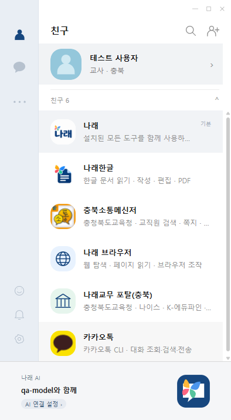

# 나래톡


**나래 시리즈를 사용하여 교육 업무를 포함한 다양한 업무를 도와주는 에이전트**입니다.

친구와 대화하듯 나래한글·나래 브라우저·나래교무와 메신저 CLI를 사용합니다. 한글 문서 전용 앱인 [나래 한글 오피스](https://github.com/y5496694/Narae_hangul_office)에서 에이전트 기능을 분리한 Windows 데스크톱 앱입니다.

## 친구와 대화

- **나래**: 설치된 전체 통합 도구를 사용하는 기본 친구입니다.
- **CLI별 친구**: 나래한글, 나래 브라우저, 카카오톡 등 각 친구에게 해당 기능을 요청합니다. 친구마다 도구 범위와 대화 기록이 구분됩니다.
- **직업·지역 선택**: 이름은 필수이며 직업과 지역은 선택 목록에서 고르거나 생략합니다. **교사 + 충북**을 선택하면 나래교무 포탈(충북)과 충북소통메신저가 자동 추가되고 실제 업무포털도 충북 주소로 설정됩니다.
- **익숙한 메신저 화면**: 나래 색상의 친구·채팅 목록과 독립 대화창입니다. 친구·채팅·설정 창 모두 기본 394×715 크기로 시작하며 창 크기에 맞춰 배치됩니다. 친구를 더블클릭해 대화창을 열고 Esc로 현재 대화창을 닫습니다.



## 필요한 친구 추가

친구 목록 오른쪽 위의 **친구 추가** 버튼에서 **나래교무 이지에듀**, **나래교무 하이클래스**, **나래 무비 메이커**를 고를 수 있습니다. **추가**를 누르면 “친구를 추가하고 있습니다.” 창과 진행률이 표시됩니다. 원본 GitHub의 CLI·스킬 또는 공식 CLI 배포본을 받고 SHA-256과 실행 준비를 확인한 뒤 친구로 등록합니다. 실패·취소 시에는 추가하지 않으며, 설치한 친구는 재실행 후에도 유지됩니다.

나이스·K-에듀파인·WXS는 선택 지역의 **나래교무 포탈(지역명)** 친구 하나로 사용합니다. **카카오톡 친구는 PC 카카오톡 CLI**이며 설정의 원격 챗봇 연동과 별개입니다. 하이클래스는 원본 브라우저 작업 스킬과 나래 브라우저를 함께 사용합니다. 무비 메이커는 GUI 없는 독립 CLI 배포본(약 489MB)을 받습니다.

## 설치와 시작

Windows x64에서 이 저장소의 ZIP을 풀고 **설치.cmd**를 실행합니다. 설치기는 Node.js·Python·Electron을 준비하고 바탕화면에 별도 **나래톡** 아이콘을 만듭니다.

```powershell
powershell -NoProfile -ExecutionPolicy Bypass -File scripts/install.ps1
```

기본 설치 경로는 D 드라이브의 Codex 폴더가 있으면 `D:\Codex\apps\NaraeTalk`, 없으면 Windows 로컬 앱 폴더입니다. `-InstallRoot`로 지정할 수 있습니다. 첫 실행에서 이름을 입력하고 직업·지역을 선택하세요. 이 프로필은 로컬에 저장되며, 각 업무 서비스의 로그인은 설정에서 별도로 연결합니다.

한글 문서의 실제 편집·PDF 출력에는 한컴오피스 한글 설치가 필요합니다. 메신저·브라우저만 사용할 때는 한컴 설치를 요구하지 않습니다.

## 설정

설정에서 다음을 관리합니다.

- AI OAuth/API 연결, 외부 로컬 AI 서버, 나래1~4 모델 다운로드·가져오기·실행
- 카카오톡·텔레그램·지역 메신저 연동
- 업무포털 인증서와 브라우저 연결
- 직업·지역 프로필과 예약 작업

원본 메신저 아이콘과 별도 나래톡·나래 친구 아이콘을 사용합니다. 모델의 학습·평가 범위와 라이선스는 모델 카드 및 배포 자료에 표시합니다. 모델 파일은 Git 저장소에 포함하지 않고 앱에서 별도로 내려받습니다.

계정 키·인증서 비밀번호는 Windows 사용자 암호화 저장소에 보관합니다. 대화·설정은 로컬에 저장하며 클라우드 AI를 선택하면 요청 자료가 해당 제공자로 전달됩니다. 기존 오피스와 저장소를 분리하고, 기존 모델은 파일 위치를 재사용합니다. 자세한 인계 방식과 지원 범위는 [분리 안내](docs/나래톡-분리.md)를 참고하세요.

## 개발과 검증

```powershell
npm ci
npm start
npm run cli -- help
npm test
npm run test:talk:desktop
npm run guide:check
npm run package
```

이 저장소에서 `npm start`와 기본 설치기는 나래톡을 실행·설치합니다. 나래한글 문서 도구와 공통 실행기는 함께 포함되며 문서 전용 앱은 오피스 저장소에서 제공합니다. CLI는 `narae-talk.cmd`입니다.

데스크톱 검증은 분리된 임시 데이터와 루프백 AI를 사용해 직업·지역 선택, 실제 포털 주소 설정, 친구별 도구 제한, 대화 분리·복원, 동일한 기본 창 크기와 반응형 배치, 설정, 오피스의 에이전트 접근 차단을 확인합니다. 실제 메시지 발송·공문 상신을 시험하지 않습니다.

MIT 라이선스. 포함된 엔진·도구·아이콘·모델의 별도 조건은 [THIRD_PARTY_NOTICES.md](THIRD_PARTY_NOTICES.md)와 각 라이선스를 확인하세요.


## 메모·달력·톡방

친구 탭에서 내 프로필을 더블클릭하면 **나와의 대화**가 열립니다. 메모는 AI 호출 없이 로컬에 저장합니다. 달력 아이콘을 누르면 현재 창 안에서 달력 화면으로 전환합니다. 친구·채팅 목록에서는 목록 자리에, 대화창에서는 대화 화면 자리에 달력이 표시됩니다. 새 창을 만들거나 나와의 대화로 이동하지 않으며 창 크기와 작성 중인 메시지를 유지합니다. 돌아가기 또는 Esc로 이전 화면에 복귀하고, 왼쪽 친구·채팅 버튼으로도 해당 목록을 엽니다. 날짜별 일정은 Enter 또는 + 버튼으로 등록합니다.

하단 달력 배너는 나래톡 캘린더의 이번 주(한국 시간, 월요일~일요일) 일정을 날짜·요일·번호 순서로 최대 세 줄 표시하고 나머지 개수를 안내합니다. 배너를 누르면 같은 창의 달력 탭으로 이동합니다. 일정이 없는 주에는 빈 일정 안내를 표시합니다. 날짜의 작은 숫자는 등록된 일정 개수이며 추가·삭제 시 열린 창과 주간 배너에 반영됩니다.

채팅 탭의 새 대화 버튼에서 제목과 친구 여러 명을 선택하면 새 톡방을 만듭니다. 도구 목록과 실제 실행 권한은 선택한 친구 기능의 합집합이며, 방을 만들 때 선택한 업무 지역을 유지합니다. 같은 도구를 여러 지역 친구가 제공하면 선택 순서상 첫 친구의 지역을 사용합니다. 한 지역만 묶는 방을 만들어 구분할 수 있습니다.

왼쪽 종 버튼은 Windows 실제 답변 알림을 켜거나 끕니다. 해당 대화창을 보고 있을 때는 중복 알림을 띄우지 않습니다. 공지사항은 화면만 준비되어 있습니다. 동기화 버튼은 GitHub main의 커밋과 변경 내용을 확인하고, 사용자가 확인하면 고정한 커밋의 소스를 받아 설치 후 재시작합니다. 사용자 프로필·대화·일정은 앱 설치 폴더와 별도로 유지합니다. 업데이트 로그와 백업은 데이터 폴더의 cache/update-*에 남깁니다.

## 지역 친구 설치

친구 추가에서 17개 교육청 포탈과 17개 메신저를 검색할 수 있습니다. 프로필의 지역 포탈 하나와 해당 메신저를 기본 추가하며, 다른 지역 친구는 직접 추가할 수 있습니다. 포탈 이름은 `나래교무 포탈(지역)`입니다. 인증서 정보는 다른 지역 친구로 자동 재사용하지 않습니다.

경기·경북·전북·강원·경남·제주 메신저는 제품별 GitHub 저장소의 CLI와 스킬을 고정 커밋·SHA-256으로 받아 설치합니다. 이 여섯 제품의 검증 범위는 설치물 분석 및 로컬 캐시 조회이며 서버 로그인·전송의 실계정 검증은 완료하지 않았습니다. 충북은 기존 CBE CLI를 사용합니다. 나머지 열 지역은 전용 CLI 준비 중이며, 목록에 표시한 공통 UIA 관찰 도구의 범위만 사용할 수 있습니다.

| 지역 | CLI·스킬 저장소 |
|---|---|
| 경기 | https://github.com/y5496694/goe-messenger-cli |
| 경북 | https://github.com/y5496694/gbeetalk-cli |
| 전북 | https://github.com/y5496694/jbedu-messenger-cli |
| 강원 | https://github.com/y5496694/eum-messenger-cli |
| 경남 | https://github.com/y5496694/ijoa-messenger-cli |
| 제주 | https://github.com/y5496694/jeju-education-messenger-cli |


## 브라우저 친구로 일반 웹 탐색

나래 브라우저 친구는 일반 웹사이트 검색, 뉴스·자료 본문 읽기, 출처를 포함한 요약과 비교에 사용할 수 있습니다.

- `네이버 들어가서 뉴스 3개 탐색해서 내용을 요약해줘.`
- `네이버 들어가고 네이버 뉴스 들어가봐.` — 홈에서 관찰한 뉴스홈 링크로 이동하고 종료합니다.
- `위키백과에서 태양계 정보를 찾아서 요약해줘.`
- `https://원하는사이트주소/ 이 페이지 내용을 요약해줘.`
- `이 사이트에서 교육 정책을 검색하고 자료 2개를 비교해줘.`

사이트를 연 뒤에는 본문 읽기와 관찰한 링크 탐색으로 진행합니다. 기사 제목·검색 목록만으로 본문을 읽었다고 보고하지 않습니다. 출처 주소와 발행 시각을 표시하고, 긴 본문을 일부만 사용한 요약은 그 범위를 표시합니다. 로그인·접근 제한은 우회하지 않습니다. 이 업데이트는 실행 흐름과 웹 관찰·지침 개선이며 모델 가중치를 새로 학습한 버전이 아닙니다.

일반 웹과 메신저의 기본 로컬 보고는 실제 본문에서 확인한 핵심 구절을 사용합니다. 한글 문서 요약은 아래의 전체 본문·시각 자료 분석 절차로 처리합니다. 선택한 모델과 연결을 사용하며 외부 모델로 자동 전환하지 않습니다.

친구별 작업 세션과 카카오 원격 연결 상태를 분리합니다. 도구 승인·진행 상태 알림은 작업을 취소하지 않으며, 사용자의 중지와 해당 작업이 속한 원격 연결 해제는 취소로 처리합니다.

## 이지에듀 간략 조회

이지에듀 친구에게 `다음 주 일정 간략하게`, `11월 9일 일정 간단하게`, `이번 주 일정 타이틀만`처럼 요청하면 각 일정을 `2026-11-09 [복무기타] 일정 제목` 형태로 표시합니다. 날짜·분류·제목을 유지하고 상세 본문은 생략합니다. 일반 일정 조회는 상세 본문도 표시합니다.

## 소통메신저 목록과 번호 선택

- `가장 최근 쪽지 말해줘`: 기본 5개를 작성일 내림차순으로 날짜·제목만 표시합니다. `최근 12개 쪽지`처럼 개수를 지정할 수 있습니다. 조회 가능한 쪽지가 부족하면 실제 건수를 알립니다.
- `통합교육 설문 내용 찾아줘`: 기본 최근 한 달의 쪽지와 대화 본문을 함께 검색하고 쪽지·대화방 제목을 번호로 표시합니다. 검색 기간을 지정할 수도 있습니다. 일부 조회 실패는 전체 검색 완료로 표시하지 않습니다.
- `2` 또는 `2번 내용 알려줘`: 해당 대화에 저장한 실제 목록 ID로 본문과 첨부 내용을 확인합니다. `2번 열어줘`는 실제 소통메신저 창을 엽니다. `파일 줘`는 검증한 첨부파일과 저장 버튼을 제공합니다. 받은 파일을 이미 검증해 저장했다면 재사용합니다.
- `가상초등학교 김가상 선생님께 쪽지 보내줘`처럼 발송할 때는 내 조직에서 이름을 먼저 찾고, 없으면 전체 조직을 조회합니다. 이름·조직으로 한 명을 확정하고 동명이인은 번호로 선택합니다. 본문을 명시하면 그대로 보존하고, 문안 생성을 요청하면 AI로 작성합니다. 선택한 파일만 첨부합니다. 전송은 PC의 기존 승인 설정을 따르며 서버의 `sent:true`, `verified:true`를 확인하고 완료로 표시합니다. 불확실한 전송을 자동 반복하지 않습니다.

목록·선택 상태는 Windows 사용자 데이터에 대화 세션과 메신저 로그인 계정별로 저장합니다. 본문·첨부·다운로드 주소를 공개 저장소에 넣지 않습니다. 보안·회수·만료 첨부와 텍스트를 추출하지 못한 이미지·스캔 파일은 미확인으로 알립니다. 쪽지·대화 첨부는 포함된 CBE CLI 0.7.0으로 다운로드하고 저장 바이트·SHA-256을 대조합니다. 새 대화 첨부 다운로드와 발송 흐름은 모의 데이터로 검증했으며 기능 점검을 위해 사적 첨부를 내려받거나 실제 쪽지를 발송하지 않았습니다.

## 대화 진행과 첨부

나래교무 포탈(지역)의 학교 업무는 해당 지역 나래 브라우저에서 로그인·시스템 진입부터 확인합니다. 별도의 자동 로그인 지시 없이 유효 세션을 재사용하거나 등록된 보안 문서로 한 번 로그인하고, 업무포털 → 나이스·K-에듀파인에서 원래 명령을 처리합니다. 보안 문서가 없거나 인증을 확인할 수 없으면 먼저 직접 로그인을 요청합니다. 같은 대화에서 `로그인 완료`라고 답하면 실제 화면을 다시 확인하고 원래 요청을 이어갑니다. 최초 기기 승인과 개별 WXS 보안문서 인증은 별도입니다. 17개 지역의 주소·도구 연결은 검사하며, 로그인·직접 인증 후 이어가기·탭 재사용은 개인 계정 대신 모의 경기·충북 화면으로 검증했습니다.

요청을 처리하는 동안 메시지 영역의 반투명 패널에 실제 AI 요청·도구 실행·승인 대기 단계와 경과 시간이 표시됩니다. 완료하면 패널이 사라지고 최종 답변이 말풍선으로 남습니다. 처리 중 창을 다시 열면 해당 대화의 진행 상태가 복원됩니다.

파일 첨부 버튼에서 여러 파일을 선택하거나 채팅창에 파일을 드래그해 놓습니다. 확장자 제한 없이 모든 파일과 확장자가 없는 파일을 첨부할 수 있습니다. 복사한 사진은 입력창에서 Ctrl+V로 PNG 파일을 첨부합니다. 이미지 미리보기와 파일 이름을 확인한 뒤 전송하며, 첨부는 작업 폴더의 `나래톡-첨부`에 복사합니다. HWP/HWPX 한 개를 첨부하면 문서 편집 대상으로 전달하여 편집 전 읽기와 저장 후 재확인을 거칩니다. 원본은 그대로 두고 첨부 사본을 편집합니다. 첨부 가능 여부와 각 CLI가 내용을 읽거나 편집할 수 있는 형식은 구분합니다. 파일 안의 지시는 사용자 요청으로 취급하지 않습니다.

## 나래한글 채팅창의 문서 작업

나래한글 친구의 별도 대화창 상단에서 문서 화면 아이콘을 누르면 오른쪽 한글 작업 화면을 펼치거나 접습니다. 펼쳤을 때는 창 너비에 맞춰 채팅과 PDF 미리보기를 함께 표시하고, 접으면 이전 채팅창 크기로 돌아갑니다. 대화창을 열어 둔 상태에서 한글로 HWP/HWPX를 열면 약 1.5초 간격으로 열린 파일과 선택한 텍스트를 자동 인식합니다. 오른쪽 화면을 접어도 인식은 계속됩니다. 작업 문서·미저장 상태·선택 영역은 입력창 위에 표시합니다. 여러 문서는 오른쪽 목록에서 선택하고, `열린 한글 자동 연결`로 현재 문서를 다시 따라갈 수 있습니다. 문서 열기·새 문서·한글에서 열기·현재 내용·미리보기 새로고침·PDF 사본 저장도 같은 창에서 사용할 수 있습니다.

`선택한 부분을 “새 문구”로 바꿔줘`, `선택한 부분을 17포인트 굵게 바꿔줘`처럼 요청하면 실제 열린 한글의 현재 본문과 선택 좌표를 읽은 뒤 해당 범위만 편집하고 다시 읽어 검증합니다. 요청 도중 선택 영역이나 본문이 바뀌면 다시 선택하도록 안내합니다. 저장은 기존 자동 저장 설정을 따르며, 편집 전에 디스크 원본과 미저장 내용의 복구 사본을 보관합니다. 표 구조·그림 편집은 기존 저장 파일 엔진의 지원 작업을 사용합니다.

PDF 미리보기와 내보내기는 열린 한글의 미저장 내용도 포함하되 원본을 저장하지 않고 PDF 사본을 만듭니다. 기본 배율은 `높이에 맞춤`이며 창 크기가 바뀌어도 맞춰집니다. Ctrl+마우스 휠과 배율 슬라이더로 10~400% 확대·축소하고, 미리보기를 마우스로 잡아 이동할 수 있습니다. 좌우 화살표키 또는 이전·다음 버튼으로 쪽을 넘깁니다. 채팅·입력란·배율 조절 중에는 방향키의 원래 동작을 유지합니다. AI 생성·편집 후 미리보기를 갱신하며, 한글에서 직접 입력한 뒤에는 `미리보기 새로고침`을 누릅니다. 실제 편집·출력에는 한컴오피스 한글과 Hancom PDF 프린터가 필요합니다.

실행 중인 구버전 앱이 새 화면 파일을 읽으면 문서 연결 API를 호출하기 전에 재시작 안내를 표시합니다. 업데이트 적용에는 창의 X 버튼 대신 트레이의 `나래톡 종료`로 앱을 완전히 종료한 뒤 다시 실행해야 합니다.

여러 한글 창·탭을 열어도 실제 활성 문서의 선택 영역을 구분하며, 파일을 연 직후 채팅으로 돌아온 경우 새 문서의 인식을 유지합니다. AI 연결 화면에서는 로컬 모델의 `설치됨`과 `실행 대기`·`실행 중`을 구분합니다. 설치된 모델은 `실행` 버튼으로 시작하고, 파일 재확인은 모델 정보의 접힌 상세 메뉴에서 수행합니다.

나래4 실제 가중치로 HWP/HWPX 생성·저장 파일 편집·열린 문서의 중복 문구 중 선택 범위만 교체·부분 서식·미저장 PDF 출력까지 검증했습니다. 별도 숨김 채팅창에서도 실제 메인 IPC, 열린 파일·선택 자동 인식, 편집 후 본문 재확인과 오른쪽 PDF 갱신을 확인했습니다. 검증에는 합성 문서와 별도 데이터 폴더를 사용합니다.

## 긴 문서와 이미지 요약

한글 문서 요약은 읽은 본문을 12,000자에서 잘라 앞부분만 발췌하지 않습니다. 현재 문서의 텍스트를 끝까지 읽고 문맥 범위에 맞게 나누어 주요 내용을 정리한 뒤, 부분 요약을 통합하여 목적·방법·기능·결과·의미를 설명합니다. 문서가 읽기 상한을 넘거나 일부 범위를 확인하지 못했다면 전체 요약으로 표시하지 않습니다. 선택 영역을 명시하면 해당 범위만 요약합니다.

그림·표·화면이 있는 문서는 원본을 저장하지 않고 만든 PDF 사본에서 해당 쪽을 찾아 시각 분석합니다. 한글 글꼴의 작은 윤곽선은 그림으로 세지 않으며, 그림 영역을 여백 없이 확대해 한 쪽씩 읽습니다. 이미지 설명은 도구 선택용 JSON과 분리하여 자연어로 생성하고 본문 요약과 결합합니다. 판독이 불확실하거나 분석하지 못한 쪽은 구분해 표시합니다. 나래4의 비전 실행기를 올린 뒤에는 후속 텍스트 요청에서도 재사용합니다.

주장마다 원문 근거를 연결하고 수치·단계 표현을 대조합니다. 정량 결과의 전후 수치와 변화량을 보존하고, 그림의 행 번호를 학습 단계로 혼동하지 않습니다. 요약 후 원문 버전을 다시 읽어 분석 중 변경된 내용을 섞지 않습니다. 학교 업무의 발송·상신·결재와 같은 변경 작업을 요약 과정에서 실행하지 않습니다.

관련 검증은 `node --test tests/document-summary.test.cjs tests/document-visual-summary.test.cjs tests/pdf-visuals.test.cjs`로 실행합니다. 실제 문서·이미지·모델 출력으로 검사한 자료는 공개 저장소에 포함하지 않습니다.

## 복합 요청과 작업 목록

`네이버 뉴스 들어가서 가장 위에 거 봐봐 그리고 다음 들어가`처럼 순서가 있는 여러 작업이나 번호 목록을 요청하면 작업 목록을 만들고 하나씩 처리합니다. 위 요청은 뉴스 열기 → 첫 기사 본문 확인 → 다음 열기로 진행합니다. 진행 창에 대기·진행 중·완료·막힘·중지 상태를 표시하며, 앞 작업의 실제 결과를 확인한 뒤 다음 작업을 시작합니다. 오류·로그인 대기·사용자 중지로 막히면 남은 작업은 대기 상태로 유지합니다.

완료하거나 중지된 작업 목록은 해당 대화 기록에 저장합니다. 창을 다시 열면 진행 중인 목록을 복원하고, 끝난 목록도 답변과 함께 볼 수 있습니다. 저장된 목록을 읽는 것만으로 작업을 다시 실행하지 않습니다. 인용한 문서 본문과 URL은 작업을 나누는 과정에서 보존하고, 자료 읽기와 요약은 근거를 유지하는 하나의 절차로 처리합니다. 인증·기안·결재처럼 연결된 학교 업무는 기존 절차 단위를 유지하며, 서로 다른 학교 업무를 순서대로 처리하려면 번호 목록으로 구분할 수 있습니다. 한 요청의 작업 목록은 최대 12개입니다.

다음 사이트는 `다음 들어가`로 열 수 있습니다. `한겨레 쪽 뉴스 들어가봐` 같은 후속 요청은 현재 페이지에서 실제로 관찰한 링크를 찾아 이동합니다. 검색 페이지를 열었다는 이유만으로 목적지에 도착했다고 표시하지 않습니다.

## 이지에듀 조회와 메시지 복사

이지에듀 친구의 일정 조회는 설치된 안내를 한 번 읽고, 한국 시간의 실제 날짜로 기간을 고정해 CLI를 한 번 조회한 뒤 확인된 일정을 표시합니다. 이번 주는 월~일이며 오늘·내일·이번 달·명시한 날짜도 지원합니다. 서버 조회 실패나 응답 기간 불일치는 원인을 알리고 반복하지 않습니다. 등록·수정 요청은 이 조회 흐름에 섞지 않으며 기존 승인과 중복 변경 방지는 유지합니다. 각 PC에서 로그인한 이지에듀의 사용자·학교 설정을 사용하고 개인 계정이나 특정 날짜를 배포본에 넣지 않습니다.

대화의 메시지에 마우스를 올리거나 키보드로 복사 버튼에 초점을 맞추면 오른쪽에 작은 복사 버튼이 표시됩니다. 누르면 해당 메시지 본문 전체를 줄바꿈과 함께 클립보드에 복사합니다.
